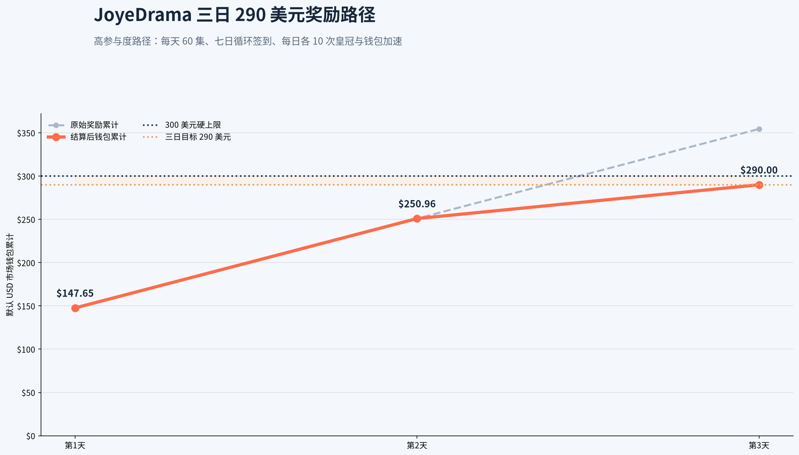

# JoyeDrama 三日 290 美元奖励模型

**版本：** v1.7.0.1
**日期：** 2026-09-29
**适用市场：** 默认 USD 市场（10,000 内部单位 = US$1.00）

## 结论

奖励曲线维持 **3,000,000 内部单位 / US$300.00 的生命周期硬上限**。按本次确认的规则——**七日循环签到、钱包加速每天 10 条、皇冠主动加速每天 10 条**——完整高参与度路径在第 3 天结算为 **2,900,008 内部单位**，钱包展示为 **US$290.00**，距离硬上限仍保留 **99,992 单位（约 US$10.00）**。

> 8 个内部单位（US$0.0008）的差异来自每笔奖励在服务端阻尼层的向下取整；模型容差设为 100 单位，钱包两位小数展示为 **US$290.00**。这不是对用户收入的公开承诺，而是用于内部资格路径、广告量与上限保护的高参与度测算。



## 高参与度资格路径

三天内每天完成以下动作，模型与服务端的事件顺序一致：

1. 领取七日循环签到中的当天奖励；
2. 完成 **10 次皇冠之路主动加速**（每条广告增加 1 点皇冠成长积分）；
3. 完整观看 **60 集**，并领取所有当天追剧任务；
4. 聚合领取当天分集奖励；
5. 完成 **10 次钱包加速**（每条直接结算 1,000 内部单位的原始奖励）。

皇冠主动加速只增加皇冠成长积分，不直接增加钱包奖励。资格路径中：第 1 天达到青铜与白银，第 2 天达到黄金；相应的单集倍率仅对达成后的后续剧集生效，符合服务端的先创建分集奖励、再结算皇冠等级的处理顺序。

| 日末 | 累计结算内部单位 | 默认 USD 市场钱包累计 | 当日原始奖励投入 | 说明 |
|---|---:|---:|---:|---|
| 第 1 天 | 1,476,460 | US$147.65 | 1,476,460 | 新人奖励、签到、皇冠主动加速、60 集、全部任务和 10 次钱包加速均处于第一阻尼档。 |
| 第 2 天 | 2,509,640 | US$250.96 | 1,033,180 | 黄金皇冠提前达成并提高后续分集奖励。 |
| 第 3 天 | 2,900,008 | US$290.00 | 1,035,560 | 进入多档阻尼后平滑收敛，未触碰 300 万硬上限。 |
| 三日合计 | **2,900,008** | **US$290.00** | 3,545,200 | 高参与度资格路径完成。 |

### 三日已结算来源

| 来源 | 已结算内部单位 | 说明 |
|---|---:|---|
| 新人欢迎奖励 | 600,000 | 首日完整领取。 |
| 七日循环签到（第 1–3 天） | 60,000 | 10,000 / 20,000 / 30,000。 |
| 皇冠等级奖励 | 104,000 | 青铜、白银、黄金达成。 |
| 分集奖励 | 1,317,308 | 基础单集奖励为 7,784 单位，受皇冠倍率和阻尼影响。 |
| 每日追剧任务 | 797,500 | 14 个日任务节点，第三天受阻尼影响。 |
| 钱包加速 | 21,200 | 每天 10 次，共 30 次；第三天受阻尼影响。 |
| 皇冠主动加速 | 0 | 只增加成长积分，不直接记入钱包。 |
| **合计** | **2,900,008** | 钱包显示 US$290.00。 |

## 服务端配置

新增迁移 [`030_v1701_seven_day_cycle_ten_active_boosts.sql`](../../services/rewards/sql/030_v1701_seven_day_cycle_ten_active_boosts.sql)。迁移只影响后续结算；已有账本、已领取新人奖励、已达成皇冠等级均不被重写。

| 参数组 | 新值 | 说明 |
|---|---|---|
| 签到周期 | **7 天循环** | 服务端第 7 天后回到第 1 天；快照和客户端仅返回 7 个签到档位。 |
| 七日签到奖励 | 10,000 / 20,000 / 30,000 / 40,000 / 50,000 / 60,000 / 70,000 单位 | 前三日用于资格路径；后四日保持递增的周循环激励。 |
| 单集基础奖励 | **7,784 单位** | 与每日 20 次主动加速共同校准，使三日路径按两位小数显示为 US$290.00。 |
| 钱包主动加速 | **1,000 单位 / 次；每天 10 次；30 秒冷却** | 原始奖励直接进入同一钱包账本，仍受统一阻尼和硬上限保护。 |
| 皇冠主动加速 | **每天 10 次；每次 +1 积分；30 秒冷却** | 不直接付现；通过更早解锁皇冠等级影响后续分集奖励。 |
| 皇冠自然观看积分 | 每完整剧集 +2 积分 | 与主动加速积分共同用于皇冠等级判断。 |
| 硬上限 | 3,000,000 单位 / US$300.00 | 所有奖励来源共享同一上限。 |
| 阻尼阈值 | 2,650,000 / 2,780,000 / 2,860,000 / 2,920,000 / 2,970,000 | 临近上限时逐档收敛，避免突然停止结算。 |
| 阻尼系数 | 1.00 / 0.50 / 0.25 / 0.12 / 0.06 / 0.01 | 服务端按每笔奖励结算前的累计进度执行。 |

## 广告参与量与运营边界

该模型的三日完整参与路径包含：

| 广告类型 | 每日数量 | 三日数量 | 模型归类 |
|---|---:|---:|---|
| 新人欢迎奖励激励广告 | 第 1 天 1 | 1 | 内容流 RV |
| 签到激励广告 | 1 | 3 | 内容流 RV |
| 解锁激励广告（前 3 集免费、每条解锁 2 集） | 29 | 87 | 内容流 RV |
| 追剧任务领取激励广告 | 14 | 42 | 内容流 RV |
| 日末分集奖励聚合领取广告 | 1 | 3 | 内容流 RV |
| 皇冠主动加速广告 | 10 | 30 | 奖励中心 RV |
| 钱包主动加速广告 | 10 | 30 | 奖励中心 RV |
| **全部激励广告** | — | **196** | 不含加载失败回退与计时/转场插屏 |

广告填充率、展示成功、完成率、作弊检测、地区合规和广告平台实际收入均不在该模型中预测。上线前应使用 TopOn 的 paid-impression 数据与真实留存数据重新验证单位经济。

## 可编辑 Excel 与可复现数据

默认工作簿为中文阶梯充能版：

- [JoyeDrama_三日300美元_阶梯充能广告测算模型.xlsx](JoyeDrama_三日300美元_阶梯充能广告测算模型.xlsx)
- [逐笔结算记录（CSV）](settlements.csv)
- [模型摘要（JSON）](summary.json)
- [可复现模型脚本](../../services/rewards/tools/model_300usd_three_day.py)
- [Excel 导出器](../../services/rewards/tools/export_300usd_ladder_charge_xlsx.py)

工作簿沿用旧版的 **蓝色 Inputs → 隐藏 Engine → 三情景 Daily → Summary / Milestones / Ad_Points** 结构。修改蓝色输入后可用 Excel `Ctrl+Alt+F9` 或 LibreOffice `Ctrl+Shift+F9` 重算。

可通过以下命令生成数据、曲线图和 Excel：

```bash
cd services/rewards
python3 tools/model_300usd_three_day.py --output-dir ../../docs/reward-model-300usd-3days
python3 tools/export_300usd_ladder_charge_xlsx.py \
  --output ../../docs/reward-model-300usd-3days/JoyeDrama_三日300美元_阶梯充能广告测算模型.xlsx
```
